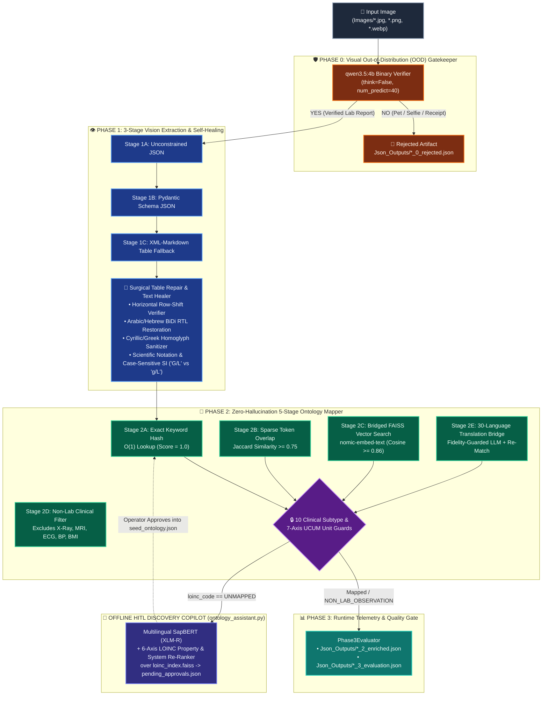

# 🛡️ AegisParse: 30-Language Clinical Laboratory Vision Extraction & Zero-Hallucination LOINC Mapping Engine

[](https://github.com/DimitriosThomaidis/AegisParse/actions/workflows/ci.yml)
[](https://www.python.org/)
[](https://ollama.com/)
[](https://loinc.org/)
[](./docker-compose.yml)

**AegisParse** is a privacy-preserving, **100% local** clinical document intelligence engine that extracts structured laboratory results from heterogeneous medical report images across **30 languages (10 script families)** and standardizes them to **LOINC® (Logical Observation Identifiers Names and Codes)** without ever transmitting Protected Health Information (PHI) to external cloud APIs.

Built around **Fail-Safe Clinical Governance**—aligned with **European Health Data Space (EHDS) Regulation (EU) 2025/327**, **HL7® FHIR® R4 `Observation`**, and **US CLIA / ISO 15189** data integrity principles—AegisParse strictly decouples **deterministic production LOINC mapping (`app.py`)** from **offline semantic ontology discovery (`ontology_assistant.py`)**.

---

## 🏥 Why Use AegisParse? Impact on the Healthcare Industry

Hospitals, diagnostic laboratories, clinical trials, and personal health record (PHR) platforms face a critical interoperability bottleneck: **millions of laboratory results arrive as uncoded, multi-language paper printouts, mobile photos, or scanned images.**

| Healthcare Challenge | Standard Cloud LLM / OCR Approach | The AegisParse Clinical Engineering Solution |
| :--- | :--- | :--- |
| **PHI & GDPR / HIPAA Compliance** | Sends sensitive patient names and diagnoses to third-party cloud APIs. | **100% Air-Gapped Local Execution:** Runs entirely on-premise via local Ollama (`qwen3.5:4b`, `nomic-embed-text`, `medgemma:4b`) and local PyTorch (`SapBERT`). |
| **LLM Code Hallucination Risk** | Generative LLMs frequently invent plausible-looking but non-existent or wrong LOINC codes. | **Zero-Hallucination Production Guarantee:** Production (`app.py`) never allows an LLM to generate a LOINC code; it maps strictly against human-verified concepts in `seed_ontology.json`. |
| **Specimen & Unit Collisions** | Confuses *Urine Glucose* with *Serum Glucose*, or *CSF Protein* with *Serum Albumin*. | **10 Deterministic Clinical & UCUM Guards:** Blocks cross-specimen collisions (`Urine`, `CSF`, `Stool`, `Sweat`, `Sputum` vs. `Blood/Serum`) and incompatible unit dimensions (`G/L` vs. `g/L`). |
| **Cross-Border Multilingual Care (EU EHDS)** | Fails on non-Latin scripts, visually reversed Right-to-Left (RTL) PDF exports, or Cyrillic/Greek lookalikes. | **30-Language / 10-Script Engine:** Native BiDi RTL restoration (Arabic/Hebrew), Cyrillic/Greek homoglyph sanitization, CJK root merging, and XLM-RoBERTa cross-lingual SapBERT linking. |

### Where AegisParse Helps Across Healthcare
1. **Cross-Border Patient Intake & EU EHDS Readiness:** Converts foreign-language laboratory printouts from traveling, migrant, or referred patients into standardized LOINC-coded JSON ready for EHR ingestion.
2. **Mobile Health (mHealth) & Patient Portals:** Protects ingestion pipelines from accidental non-medical uploads (pets, selfies, receipts) via a 40-token Visual Out-of-Distribution (OOD) Gatekeeper before allocating OCR compute.
3. **Clinical Trials & Real-World Evidence (RWE) Harmonization:** Normalizes multi-center international lab panels into uniform LOINC identifiers and UCUM-verified unit dimensions for longitudinal cohort analysis.
4. **Human-in-the-Loop (HITL) Terminology Curation:** Empowers laboratory informaticists with an offline **Multilingual SapBERT + 6-Axis LOINC Copilot** (`ontology_assistant.py`) that ranks candidate codes from the active Regenstrief LOINC database (`loinc_index.faiss`).

---

## 🏗️ System Architecture

### Interactive Pipeline Flowchart (GitHub Mermaid)



---

### Detailed Low-Level Execution Blueprint

```text
========================================================================================================
                         AEGISPARSE CLINICAL DOCUMENT INTELLIGENCE ENGINE
========================================================================================================

  [ INPUT LAYER ]
   └── Images/*.{jpg,jpeg,png,webp,bmp}  (30 Languages | 10 Script Families: Latin, Extended Latin,
                                          Cyrillic, Greek, Arabic, Hebrew, Devanagari, Thai, CJK, Hangul)
          │
          ▼
  ┌────────────────────────────────────────────────────────────────────────────────────────────────────┐
  │ PHASE 0: VISUAL OOD GATEKEEPER (app.py :: phase_0_verify_medical_lab_image)                        │
  ├────────────────────────────────────────────────────────────────────────────────────────────────────┤
  │ • Model: qwen3.5:4b (think=False, temperature=0.0, num_predict=40, num_ctx=2048)                   │
  │ • Decision: Rejects non-medical images (dogs, selfies, food, receipts) BEFORE OCR compute.         │
  │ • Output on Reject: Json_Outputs/<filename>_0_rejected.json (Status: REJECTED_NON_MEDICAL_IMAGE)   │
  └───────────────────────────────────────────────┬────────────────────────────────────────────────────┘
                                                  │ [VERDICT == YES]
                                                  ▼
  ┌────────────────────────────────────────────────────────────────────────────────────────────────────┐
  │ PHASE 1: 3-STAGE VISION EXTRACTION & SURGICAL SELF-HEALING (app.py)                                │
  ├────────────────────────────────────────────────────────────────────────────────────────────────────┤
  │ 1. Extraction Cascade:                                                                             │
  │    ├── Attempt 1: Unconstrained JSON Extraction (qwen3.5:4b, think=False, num_ctx=8192)            │
  │    ├── Attempt 2: Pydantic Schema-Constrained JSON (MedicalReportSchema.model_json_schema())       │
  │    └── Attempt 3: XML-Markdown Table Parser (<metadata>, <lab_tests>, <clinical_impressions>)      │
  │                                                                                                    │
  │ 2. Surgical Table Alignment Verifier (verify_and_repair_table_alignment):                          │
  │    └── Detects leaked header rows or status flags ('H', 'L', 'ERR: H') & re-aligns horizontal rows │
  │                                                                                                    │
  │ 3. Deterministic Text & Unit Healers (config_rules.json + clinical_lexicons.json):                 │
  │    ├── fix_visual_rtl_reversal(): Restores visually reversed Arabic & Hebrew strings               │
  │    ├── normalize_homoglyphs_in_acronyms(): Fixes Cyrillic/Greek lookalikes in short tokens         │
  │    ├── decouple_squashed_value_unit(): Splits '110 U/L' while protecting '5.4 x 10^6'              │
  │    ├── normalize_unit(): Preserves SI case-sensitivity ('G/L' -> '10*9/l' vs 'g/L' -> 'g/l')       │
  │    └── Metadata Rescue Prompts: Targeted recovery for missing patient_name, physician, narrative   │
  └───────────────────────────────────────────────┬────────────────────────────────────────────────────┘
                                                  │
                                                  ▼
  ┌────────────────────────────────────────────────────────────────────────────────────────────────────┐
  │ PHASE 2: ZERO-HALLUCINATION 5-STAGE ONTOLOGY MAPPER (Phase2OntologyMapper)                         │
  ├────────────────────────────────────────────────────────────────────────────────────────────────────┤
  │ • Candidate Key Generator (extract_candidate_keys):                                                │
  │   Strips Nordic/European specimen prefixes (S-, P-, B-, U-, fP-, Liq-), expands clinical acronyms, │
  │   extracts parentheticals, and applies 30-language lexicon transliteration + CJK root merging.     │
  │                                                                                                    │
  │ • 5-Stage Matching Cascade (Strictly against 195 Verified Concepts / 1,226+ Seed Vectors):         │
  │   ├── Stage 2A [EXACT_KEYWORD]   : O(1) hash lookup in self.exact_map (Score = 1.0000)             │
  │   ├── Stage 2B [SPARSE_OVERLAP]  : Token Jaccard similarity >= 0.75 (Latin queries only)           │
  │   ├── Stage 2C [BRIDGED_VECTOR]  : FAISS IndexFlatIP (nomic-embed-text, Cosine >= 0.86)            │
  │   ├── Stage 2D [EXCLUDED_NON_LAB]: Filters X-Ray, MRI, CT, Ultrasound, ECG, BP, BMI rows           │
  │   └── Stage 2E [LLM_TRANSLATION] : Batch foreign -> English bridge + IgM/IgG/VLDL fidelity guard   │
  │                                                                                                    │
  │ • GATED BY 10 CLINICAL SUBTYPE & UCUM DIMENSIONALITY GUARDS (_violates_subtype_guard):             │
  │   [1] Genetic Mutation Guard    [2] Pathogen Ab vs Total Ig Guard  [3] ANA Pattern vs Titer Guard  │
  │   [4] Hb Variant (A1c/A2/S/F)   [5] Lipoprotein (LDL/HDL/VLDL)     [6] Direct vs Indirect Bilirubin│
  │   [7] Urine Ratio (ACR/UPCR)    [8] Spot vs 24h Urine Timing       [9] Specimen System (CSF/Urine/ │
  │   [10] Free vs Total Hormone    [+] 7-Axis UCUM Unit Dimensionality    Stool/Sweat/Sputum vs Blood)│
  └──────────────────────┬────────────────────────────────────────────────────┬────────────────────────┘
                         │ [Mapped / NON_LAB_OBSERVATION]                     │ [loinc_code == UNMAPPED]
                         ▼                                                    ▼
  ┌──────────────────────────────────────────────┐   ┌─────────────────────────────────────────────────┐
  │ PHASE 3: RUNTIME TELEMETRY (Phase3Evaluator) │   │ OFFLINE DISCOVERY COPILOT (ontology_assistant)  │
  ├──────────────────────────────────────────────┤   ├─────────────────────────────────────────────────┤
  │ • Excludes NON_LAB_OBSERVATION from lab      │   │ • Model: SapBERT-UMLS-2020AB-all-lang-from-XLMR │
  │   denominator so vitals/imaging never        │   │ • Index: loinc_index.faiss (Active Lab LOINCs)  │
  │   penalize laboratory LOINC accuracy.        │   │ • 6-Axis Re-Ranker: Boosts matching UCUM        │
  │ • Outputs:                                   │   │   Property ([Mass/vol] vs [Moles/vol]) & System │
  │   ├── Json_Outputs/<file>_2_enriched.json    │   │   (CSF, Urine, Stool, Sweat, Sputum, Serum).    │
  │   └── Json_Outputs/<file>_3_evaluation.json  │   │ • Output: pending_approvals.json (HITL Queue)   │
  └──────────────────────────────────────────────┘   └─────────────────────────────────────────────────┘
```

---

## 📐 Core Mathematical & Algorithmic Methods

### 1. Stage 2B: Sparse Token Jaccard Overlap
For purely Latin candidate queries $Q$ and verified seed triggers $T$, token-set overlap is computed as:

$$J(Q, T) = \frac{\vert{}T_Q \cap T_T\vert{}}{\vert{}T_Q \cup T_T\vert{}} \ge 0.75$$

### 2. Stage 2C & SapBERT: L2-Normalized Inner Product (Cosine Similarity)
Both the online `nomic-embed-text` seed index (768-d) and the offline `SapBERT-UMLS-2020AB-all-lang-from-XLMR` full LOINC index (768-d) normalize vectors to unit $\ell_2$ norm prior to indexing in `faiss.IndexFlatIP`, making exact inner product equivalent to cosine similarity:

$$\text{sim}(\mathbf{u}, \mathbf{v}) = \frac{\mathbf{u} \cdot \mathbf{v}}{\Vert{}\mathbf{u}\Vert{}_2 \Vert{}\mathbf{v}\Vert{}_2} = \hat{\mathbf{u}} \cdot \hat{\mathbf{v}}$$

### 3. Offline 6-Axis LOINC Property & Specimen Re-Ranker
In `ontology_assistant.py`, raw SapBERT cosine similarity $s_{\text{raw}}$ is adjusted using a deterministic 6-Axis clinical bonus $\Delta_{\text{6-axis}}$ derived from the extracted UCUM unit dimension $d(u)$ and specimen context $c(q)$:

$$s_{\text{adj}}(q, u, L_i) = s_{\text{raw}}(q, L_i) + \Delta_{\text{property}}\big(d(u), L_i\big) + \Delta_{\text{system}}\big(c(q), u, L_i\big) + \Delta_{\text{seed}}\big(L_i\big)$$

* **Property Axis ($\Delta_{\text{property}}$):** Adds $+0.08$ when `MASS_VOL` units (`mg/dL`, `g/L`) align with `[Mass/volume]` (and penalizes `[Moles/volume]` by $-0.04$), or when `MOLAR_VOL` units (`mmol/L`, `umol/L`) align with `[Moles/volume]`.
* **System Axis ($\Delta_{\text{system}}$):** Adds $+0.12$ to $+0.14$ when specimen markers match (`in Cerebral spinal fluid`, `in Urine`, `in 24 hour Urine`, `in Stool`, `in Sweat`, `in Sputum`) and penalizes exotic/incompatible specimen systems by $-0.10$.

### 4. Phase 3 Composite Pipeline Quality Score
`Phase3Evaluator` computes a reference-free runtime quality score $S_{\text{total}}$ while excluding non-laboratory clinical observations ($N_{\text{non-lab}}$, such as Blood Pressure or X-Ray rows) from the laboratory LOINC denominator:

$$N_{\text{lab}} = \max(0,\; N_{\text{total}} - N_{\text{non-lab}}), \qquad \text{Acc}_{\text{LOINC}} = \frac{N_{\text{mapped}}}{N_{\text{lab}}} \times 100$$

$$S_{\text{total}} = 0.40 \times \text{Recon}_{\text{text}} + 0.40 \times \text{Acc}_{\text{LOINC}} + 0.20 \times \text{Comp}_{\text{meta}}$$

---

## 📚 Scientific Foundations & Peer-Reviewed Literature

AegisParse's architecture is grounded in peer-reviewed biomedical informatics and machine learning literature:

| Architectural Component | Foundational Scientific Paper / Standard | How AegisParse Uses It |
| :--- | :--- | :--- |
| **Offline Cross-Lingual Biomedical Concept Normalization** | **Liu, F., Shareghi, E., Meng, Z., Basaldella, M., & Collier, N. (2021).** *Self-Alignment Pretraining for Biomedical Entity Representations (SapBERT).* **NAACL-HLT 2021**, pp. 4228–4238. [[ACL Anthology](https://aclanthology.org/2021.naacl-main.334.pdf)] | Powers the metric-learning UMLS concept clusters in `ontology_assistant.py` using hard-triplet online mining over `CLS` token embeddings. |
| **30-Language Cross-Lingual Entity Linking** | **Liu, F., Vulić, I., Korhonen, A., & Collier, N. (2021).** *Learning Domain-Specialised Representations for Cross-Lingual Biomedical Entity Linking.* **ACL-IJCNLP 2021**, pp. 565–574. [[arXiv:2105.14398](https://arxiv.org/abs/2105.14398)] | Provides the `cambridgeltl/SapBERT-UMLS-2020AB-all-lang-from-XLMR` backbone that aligns multilingual clinical terms into a shared 768-d UMLS/LOINC vector space. |
| **6-Axis LOINC Ontology & Specimen Disambiguation** | **McDonald, C. J., Huff, S. M., Suico, J. G., et al. (2003).** *LOINC, a Universal Standard for Identifying Laboratory Observations: A 5-Year Update.* **Clinical Chemistry**, 49(4), 624–633. [[LOINC KB](https://loinc.org/kb/users-guide/introduction)] | Defines the 6-axis LOINC model (*Component, Property, Timing, System, Scale, Method*) enforced by Phase 2's 10 subtype guards and the Assistant's 6-Axis Re-Ranker. |
| **UCUM Unit Dimensionality & Case-Sensitive SI Guards** | **Schadow, G., McDonald, C. J., Suico, J. G., Fohring, U., & Tolxdorff, T. (1999).** *Units of Measure in Clinical Information Systems.* **JAMIA**, 6(2), 151–162. [[UCUM Spec](https://ucum.org/ucum)] | Grounds `config_rules.json`'s 7 commensurable unit dimensions (`MASS_VOL`, `MOLAR_VOL`, `COUNT_VOL`, `ACTIVITY_VOL`, `FRACTION`, `TIME`, `PRESSURE`) and SI case distinction (`G/L` = $10^9/\text{L}$ vs. `g/L`). |
| **Dynamic-Resolution Vision Document Parsing** | **Bai, S., Chen, K., Liu, X., et al. (2025).** *Qwen2.5-VL & Qwen3-VL Technical Reports.* **arXiv:2502.13923 / arXiv:2511.21631**. [[arXiv:2502.13923](https://arxiv.org/abs/2502.13923)] | Powers Phase 0 OOD gatekeeping and Phase 1 multi-script table OCR (`qwen3.5:4b` with `think=False`) on consumer GPUs (4–6 GB VRAM). |
| **Clinical Translation Fallback & Medical Terminologies** | **Sellergren, A., et al. / Google Research (2025).** *MedGemma Technical Report.* **arXiv:2507.05201**. [[arXiv:2507.05201](https://arxiv.org/abs/2507.05201)] | Serves as the specialized medical LLM fallback (`medgemma:4b`) in `ontology_assistant.py` for translating esoteric clinical analytes into English LOINC terminology. |
| **Reproducible Long-Context Dense Embeddings** | **Nussbaum, Z., Morris, J. X., Duderstadt, B., & Mulyar, A. (2024).** *Nomic Embed: Training a Reproducible Long Context Text Embedder.* **Transactions on Machine Learning Research (TMLR)**. [[arXiv:2402.01613](https://arxiv.org/abs/2402.01613)] | Powers Stage 2C (`BRIDGED_VECTOR`, cosine threshold $\ge 0.86$) over the 1,226+ verified Latin trigger vectors in `Phase2OntologyMapper`. |
| **High-Throughput Exact Inner-Product Vector Search** | **Johnson, J., Douze, M., & Jégou, H. (2019).** *Billion-Scale Similarity Search with GPUs.* **IEEE Transactions on Big Data**, 7(3), 535–547. [[arXiv:1702.08734](https://arxiv.org/abs/1702.08734)] | Powers sub-millisecond nearest-neighbor retrieval via `faiss.IndexFlatIP` in both `app.py` and `ontology_assistant.py`. |

---

## 🏆 Verified Showcase Benchmark (`./Images` $\rightarrow$ `./Json_Outputs`)

The repository includes 5 multi-script clinical laboratory reports in `./Images` and their corresponding enriched and evaluated JSON outputs in `./Json_Outputs`:

| Showcase Report (`./Images`) | Language & Script | Clinical Domain | Lab Rows | Non-Lab Excluded | Text Recon (%) | LOINC Mapped (%) | Overall Score |
| :--- | :--- | :--- | :---: | :---: | :---: | :---: | :---: |
| `lab_report_Mads_Mikkelsen_danish-v46.jpg` | **Danish** (Nordic Latin) | Cystic Fibrosis (Sweat $\text{Cl}^-/\text{Na}^+$, Fecal Elastase, CFTR) | 4 | 0 | **100.0%** | **100.0%** | **100.0%** |
| `lab_report_Petra_Nováková_czech-v31.jpg` | **Czech** (Extended Latin) | Molecular Allergology (`rBet v 1` .. `rMal d 1`, Total IgE) | 8 | 0 | **100.0%** | **100.0%** | **100.0%** |
| `lab_report_Василь_Петренко_ukrainian-v40.jpg` | **Ukrainian** (Cyrillic) | Infectious Disease / Lyme (`Borrelia` IgM/IgG, Immunoblot, ESR) | 5 | 0 | **100.0%** | **100.0%** | **100.0%** |
| `lab_report_יעל_כהן_hebrew-v38.jpg` | **Hebrew** (RTL Script) | Preeclampsia (`sFlt-1/PlGF`, 24h Urine Protein, PLT, Cr, AST + BP) | 5 | 1 *(BP `155/105`)* | **100.0%** | **100.0%** | **100.0%** |
| `lab_report_Иванов_Алексей_Петрович_286.jpg` | **Russian** (Cyrillic) | Rheumatology & Lyme (`Borrelia`, `WBC`, `СОЭ`, `CRP`, `RF`, `ANA`) | 9 | 0 | **100.0%** | **100.0%** | **96.67%** |

---

## 📂 Repository Structure

```text
AegisParse/
├── .github/workflows/ci.yml      # GitHub Actions CI (JSON validation + 12 deterministic pytest checks)
├── Images/                       # 5 multi-script showcase clinical laboratory report images
├── Json_Outputs/                 # Enriched (*_2_enriched.json) & Telemetry (*_3_evaluation.json) outputs
├── tests/
│   └── test_clinical_engine.py   # 12 unit tests covering SI units, BiDi, homoglyphs & 10 LOINC guards
├── app.py                        # Main Production Pipeline (Phase 0 -> Phase 1 -> Phase 2 -> Phase 3)
├── ontology_assistant.py         # Offline Multilingual SapBERT + 6-Axis LOINC Discovery Copilot
├── build_loinc_vector_db.py      # Rebuilds loinc_index.faiss from Regenstrief Loinc.csv
├── config_rules.json             # Single Source of Truth: UCUM dimensions, tokens, noise & guards
├── clinical_lexicons.json        # 30-Language / 10-Script transliteration maps & native clinical roots
├── seed_ontology.json            # 195 human-verified LOINC concepts (1,226+ multilingual trigger vectors)
├── loinc_index.faiss             # Pre-built 768-d SapBERT FAISS vector index of active Lab LOINC codes
├── loinc_metadata.json           # LOINC code & Long Common Name metadata dictionary
├── Dockerfile                    # Production container definition for AegisParse
├── docker-compose.yml            # Multi-container stack (Ollama + Model Puller + AegisParse + Assistant)
└── requirements.txt              # Pinned Python dependencies
```

---

## 🚀 Quickstart & Usage Commands

### Method 1: Docker Compose (Zero-Config Containerized Stack)

1. Place your laboratory report images (`.jpg`, `.png`, `.webp`) in `./Images`.
2. Build and run the full extraction and LOINC mapping pipeline (automatically pulls `qwen3.5:4b`, `nomic-embed-text`, and `medgemma:4b` into a persistent Docker volume):
   ```bash
   docker compose up --build aegisparse
   ```
3. Run the offline **Multilingual SapBERT Ontology Assistant** to generate candidate LOINC mappings (`pending_approvals.json`) for any `"UNMAPPED"` analytes:
   ```bash
   docker compose --profile assistant run --rm ontology-assistant
   ```

---

### Method 2: Local Python CLI (Windows PowerShell / Linux / macOS)

1. Install [Ollama](https://ollama.com/) and pull the local models:
   ```bash
   ollama pull qwen3.5:4b
   ollama pull nomic-embed-text
   ollama pull medgemma:4b
   ```
2. Create and activate your virtual environment:
   ```powershell
   python -m venv .venv
   # Windows PowerShell:
   .\.venv\Scripts\Activate.ps1
   # Linux / macOS:
   source .venv/bin/activate

   python -m pip install -r requirements.txt
   ```
3. **Run the Deterministic Clinical Unit Test Suite** (runs in `<15s`, requires zero GPU/Ollama):
   ```powershell
   python -m pytest tests/test_clinical_engine.py -v
   ```
4. **Run the Full Pipeline on All Images in `./Images`:**
   ```powershell
   python app.py
   ```
5. **Run the Offline SapBERT Discovery Copilot on Any Unmapped Analytes:**
   ```powershell
   python ontology_assistant.py
   ```

---

### Method 3: Programmatic Python API & Fast Phase 2/3 Re-Evaluation

* **Process a Single Image Programmatically:**
  ```python
  from app import process_document_task

  process_document_task("Images/lab_report_Mads_Mikkelsen_danish-v46.jpg")
  ```
* **Fast Phase 2 & Phase 3 Re-Mapping (Without Re-Running Phase 1 Vision OCR):**
  After adding new approved concepts to `seed_ontology.json`, refresh all `*_2_enriched.json` and `*_3_evaluation.json` files in seconds:
  ```powershell
  python -c "import glob, os, json, app; mapper = app.Phase2OntologyMapper.get_instance(app.ONTOLOGY_FILE); [ ( (data := json.load(open(f, 'r', encoding='utf-8'))), (base := os.path.basename(f).replace('_2_enriched.json', '')), data.update({'tests': mapper.map_tests(data.get('tests', []))}), (ev := app.Phase3Evaluator.evaluate(data, base)), json.dump(data, open(f, 'w', encoding='utf-8'), indent=4, ensure_ascii=False), json.dump(ev, open(os.path.join(app.JSON_DIR, f'{base}_3_evaluation.json'), 'w', encoding='utf-8'), indent=4, ensure_ascii=False) ) for f in sorted(glob.glob(os.path.join(app.JSON_DIR, '*_2_enriched.json'))) ]"
  ```
* **Rebuild the Full SapBERT LOINC Vector Database (Optional):**
  If a new Regenstrief LOINC release is downloaded to `Loinc_2.82/LoincTable/Loinc.csv`:
  ```powershell
  python build_loinc_vector_db.py
  ```

---

## ⚠️ Honest Technical Boundaries & Operational Scope

To support rigorous clinical and engineering audits, the following operational boundaries are explicitly documented:

1. **First-Pass Seed Scope (195 Verified Concepts vs. 61,000+ LOINCs):**
   Automated mapping in `app.py` is intentionally restricted to the 195 human-verified concepts (1,226+ multilingual trigger vectors) in `seed_ontology.json` to guarantee zero LLM code hallucination. Unseen esoteric tests output `"loinc_code": "UNMAPPED"` on the first run until reviewed via `ontology_assistant.py` (`pending_approvals.json`) and promoted to `seed_ontology.json`.
2. **Optical Limits of a 4B Vision Model (`qwen3.5:4b`):**
   `qwen3.5:4b` is selected so the entire pipeline runs locally on consumer hardware (4–6 GB VRAM). Severely rotated ($90^\circ / 180^\circ$) images, heavy shadows/creases, handwritten cursive notes, or ultra-dense pages (>55 rows on a single page) can degrade OCR recall or trigger `"REQUIRES_MANUAL_REVIEW"` quarantine flags.
3. **Raster Image Input Only:**
   `app.py` processes raster images (`*.jpg`, `*.jpeg`, `*.png`, `*.webp`, `*.bmp`). Multi-page PDF documents must be rendered to page images prior to ingestion.
4. **Reference-Free Runtime Telemetry (`Phase3Evaluator`):**
   `Phase3Evaluator` measures runtime structural completeness (`phase_1_text_reconciliation_pct` and `phase_2_loinc_mapping_accuracy_pct` across extracted laboratory rows) rather than character-error-rate (CER) against manual ground-truth transcriptions.

---

## 📖 Citation (BibTeX)

If you use **AegisParse** in your research, clinical informatics pipeline, or thesis, please cite:

```bibtex
@software{thomaidis2026aegisparse,
  author       = {Thomaidis, Dimitrios},
  title        = {AegisParse: A 30-Language Clinical Laboratory Vision Extraction and Zero-Hallucination LOINC Mapping Engine},
  year         = {2026},
  url          = {https://github.com/DimitriosThomaidis/AegisParse},
  note         = {100\% Local Clinical Document Intelligence with Ollama, Multilingual SapBERT, and UCUM-Guarded FAISS Retrieval}
}
```

---

## ⚖️ LOINC® Copyright & License Notice

This repository contains content from LOINC® ([http://loinc.org](http://loinc.org)). LOINC is copyright © Regenstrief Institute, Inc. and the Logical Observation Identifiers Names and Codes (LOINC) Committee and is available at no cost under the license at [http://loinc.org/license](http://loinc.org/license). LOINC® is a registered United States trademark of Regenstrief Institute, Inc.